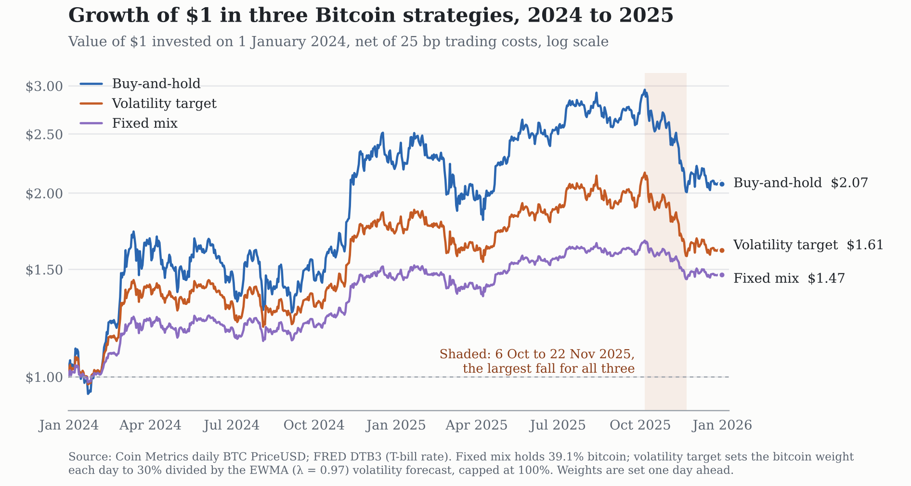

# Risk and Return Predictability in Bitcoin

An out-of-sample study of momentum and volatility models, using daily Bitcoin prices from 2018 to 2025. Course project, Central University of Finance and Economics.

## Questions and answers

| | Hypothesis | Result |
|---|---|---|
| H1 | 30-day momentum forecasts next-day returns better than the historical mean | Not supported: test-period R²_OOS = -0.017%, Clark-West t = 0.19 |
| H2 | EWMA forecasts volatility better than a 30-day rolling average | Supported: QLIKE -6.410 vs -6.361, Diebold-Mariano t = 2.45 |
| H3 | Targeting 30% volatility beats a fixed bitcoin/T-bill mix after costs | Not supported: net Sharpe 0.788 vs 0.886 (bootstrap 95% interval for the difference: -0.30 to 0.10) |

Bitcoin's risk can be forecast but its direction cannot, and in the 2024 to 2025 test years the better risk forecast did not produce a better investment rule.

## Code explorer website

`site/` is an interactive website that walks through every line of the five notebooks. Pick a day on the price chart and each step shows that day's calculation next to the code that produced it; sliders rerun the volatility forecasts and the backtest in the browser. See [`site/README.md`](site/README.md) to run or deploy it.

## Design

- **Sample split:** training 2018 to 2021, validation 2022 to 2023, test 2024 to 2025. All settings (such as the EWMA λ = 0.97) were chosen on the validation years and frozen before the test years were run once.
- **No look-ahead:** every forecast and portfolio weight uses only data available the day before.
- **Costs:** the strategy backtest charges 10, 25 or 50 basis points on every unit traded.

## How to reproduce

1. Install Python 3 and the packages: `pip install -r requirements.txt`
2. Download the data into `data_raw/`:
   - `btc.csv`: Coin Metrics community data, https://github.com/coinmetrics/data/blob/master/csv/btc.csv
   - `dtb3.csv`: 3-month T-bill rate (DTB3) from FRED, https://fred.stlouisfed.org/series/DTB3
3. Run the notebooks in `notebooks/` in order. Each one reads only files saved by the ones before it.

| Notebook | What it does |
|---|---|
| `01_data` | Loads prices, computes daily returns, saves `data_clean/btc_clean.csv` |
| `02_stats` | Risk statistics; converts the T-bill rate to a daily rate |
| `03_momentum` | Momentum regression (Newey-West errors) and out-of-sample forecasts |
| `04_volatility` | Rolling and EWMA volatility forecasts, QLIKE loss, Diebold-Mariano test |
| `05_strategy` | Backtest of buy-and-hold, fixed mix and volatility targeting; robustness checks and bootstrap |

## Main references

- Campbell, J. Y., & Thompson, S. B. (2008). Predicting excess stock returns out of sample. *Review of Financial Studies*, 21(4).
- Clark, T. E., & West, K. D. (2007). Approximately normal tests for equal predictive accuracy in nested models. *Journal of Econometrics*, 138(1).
- Diebold, F. X., & Mariano, R. S. (1995). Comparing predictive accuracy. *Journal of Business & Economic Statistics*, 13(3).
- Moreira, A., & Muir, T. (2017). Volatility-managed portfolios. *Journal of Finance*, 72(4).
- Patton, A. J. (2011). Volatility forecast comparison using imperfect volatility proxies. *Journal of Econometrics*, 160(1).
